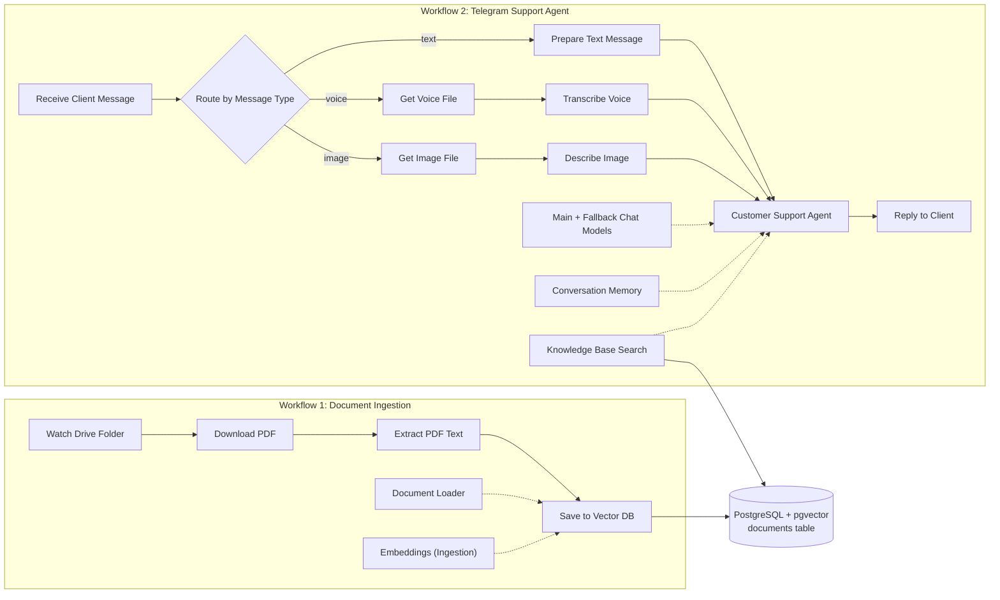

**English** | [العربية](README.ar.md)

# AI-Powered Customer Support Agent

A multimodal customer support agent for **Telegram**, built with **n8n**, **OpenAI**, and **PostgreSQL + pgvector**. It understands text, voice notes and images, answers from your own documents using Retrieval-Augmented Generation (RAG), and remembers the conversation.

## Features

- **Telegram bot** that receives client messages and replies automatically
- **Multimodal input**: text messages, voice notes (transcribed) and images (analyzed)
- **AI Agent with conversational memory**, so follow-up questions work naturally
- **RAG over your own documents** using PostgreSQL and pgvector for semantic search
- **Automatic document ingestion**: drop a PDF in Google Drive and it becomes part of the knowledge base
- **Fallback chat model**, so the agent keeps answering if the main model fails
- **Self-hosted database** in Docker, one command to start

## Architecture

The project is made of two n8n workflows that share one vector database.



**How it works**

1. **Ingestion**: when a PDF is added or updated in Google Drive, the file is downloaded, its text is extracted and split into chunks, each chunk is turned into a vector with OpenAI embeddings, and everything is stored in PostgreSQL.
2. **Chat**: a client writes to the Telegram bot. Text goes straight to the agent, voice notes are transcribed, and images are described. The agent searches the knowledge base for relevant information, uses its memory and the chat model, and sends the answer back on Telegram.

## Tech stack

| Layer | Technology |
|---|---|
| Automation | n8n |
| Messaging | Telegram Bot API |
| AI models | OpenAI (chat, transcription, image analysis, embeddings) |
| Database | PostgreSQL 16 with pgvector |
| Source of documents | Google Drive |
| Infrastructure | Docker, Docker Compose |

## Repository structure

```
.
├── README.md
├── README.ar.md
├── docker-compose.yml        # PostgreSQL + pgvector container
├── database/
│   └── setup.sql             # extensions and the documents table
├── workflows/                # exported n8n workflows (JSON)
│   └── README.md
├── docs/                     # screenshots and diagrams
├── .env.example              # copy to .env and set your password
├── .gitignore
└── LICENSE
```

## Prerequisites

- Docker Desktop (or Docker Engine) and Docker Compose
- n8n running locally in Docker (self-hosted)
- A Telegram bot token from [@BotFather](https://t.me/BotFather)
- An OpenAI API key
- A Google account for the Google Drive trigger (OAuth2 credential in n8n)

> A cloud n8n instance cannot reach a database running on your own PC. Use a local n8n, a hosted PostgreSQL with the pgvector extension, or a secure tunnel. Never expose the database port directly to the internet.

## Getting started

### 1. Start the database

```bash
git clone https://github.com/YOUR-USERNAME/ai-powered-customer-support-agent.git
cd ai-powered-customer-support-agent
cp .env.example .env        # Windows PowerShell: copy .env.example .env
```

Open `.env` and set a strong password, then start the container:

```bash
docker compose up -d
```

`database/setup.sql` runs automatically on the first start and creates the `vector` extension and the `documents` table. Check it:

```bash
docker exec -it DB.rag psql -U rag_user -d rag_db -c "\d documents"
```

You should see the columns `id`, `content`, `metadata` and `embedding`.

### 2. Connect n8n to the database

Put your n8n container on the same Docker network as the database (replace `n8n` with your container name from `docker ps`):

```bash
docker network connect rag-network n8n
```

In n8n, create a **Postgres** credential:

| Field | Value |
|---|---|
| Host | `db-rag` |
| Port | `5432` |
| Database | `rag_db` |
| User | `rag_user` |
| Password | the value in your `.env` |
| SSL | Disable (local use) |

If n8n is not running in Docker, use Host `localhost` and Port `5433` instead.

### 3. Import the workflows

In n8n, go to **Workflows → Import from File** and import the JSON files from the `workflows/` folder (see [workflows/README.md](workflows/README.md)).

### 4. Create the credentials

| Credential | Used by |
|---|---|
| Telegram API (bot token) | Telegram trigger, file download and reply nodes |
| OpenAI API | Chat models, transcription, image analysis, embeddings |
| Google Drive OAuth2 | Drive trigger and download |
| Postgres | Both vector store nodes |

### 5. Configure the vector store nodes

In both PGVector nodes (ingestion and search):

- **Table Name**: `documents`
- **Options → Column Names**: set the **Content Column** to `content` (n8n's default is `text`)
- The **embeddings model must be the same** in ingestion and search

### 6. Test it

1. Add a PDF to the watched Google Drive folder and run the ingestion workflow.
2. Check that rows were stored:
   ```bash
   docker exec -it DB.rag psql -U rag_user -d rag_db -c "SELECT id, LEFT(content, 80) AS preview FROM documents LIMIT 5;"
   ```
3. Activate the chat workflow and send a message to your Telegram bot.
4. Ask something that is in your PDF, then ask something that is not. The agent should answer the first from the documents and admit it does not know the second.

## Workflow reference

### Document Ingestion

| Node | Purpose |
|---|---|
| Watch Drive Folder | Starts the workflow when a PDF is added or updated in Google Drive |
| Download PDF | Downloads the file from Google Drive |
| Extract PDF Text | Extracts plain text from the PDF |
| Document Loader | Splits the text into chunks |
| Embeddings (Ingestion) | Turns each chunk into a vector |
| Save to Vector DB | Stores chunks and vectors in PostgreSQL |

### Telegram Support Agent

| Node | Purpose |
|---|---|
| Receive Client Message | Receives every message sent to the Telegram bot |
| Route by Message Type | Sends text, voice and image messages to their own branch |
| Prepare Text Message | Formats text messages for the agent |
| Get Voice File / Transcribe Voice | Downloads a voice note and converts it to text |
| Get Image File / Describe Image | Downloads an image and describes it in text |
| Customer Support Agent | Reasons over the question, memory and knowledge base, then answers |
| Main Chat Model / Fallback Chat Model | Primary model and backup model |
| Conversation Memory | Keeps recent conversation context |
| Knowledge Base Search | Agent tool that runs semantic search on the documents table |
| Embeddings (Search) | Turns the client's question into a vector |
| Reply to Client | Sends the answer back on Telegram |

## Everyday commands

```bash
docker compose up -d          # start the database
docker compose stop           # stop it (data is kept)
docker compose logs -f        # follow the logs
docker exec -it DB.rag psql -U rag_user -d rag_db   # open psql
```

Backup and restore:

```bash
docker exec DB.rag pg_dump -U rag_user -d rag_db > rag_backup.sql
cat rag_backup.sql | docker exec -i DB.rag psql -U rag_user -d rag_db
```

## Troubleshooting

| Problem | Fix |
|---|---|
| `extension "vector" is not available` | You are using a plain `postgres` image. Use `pgvector/pgvector:pg16`, as in `docker-compose.yml` |
| `database "db-rag" does not exist` in n8n | `db-rag` was typed in the **Database** field. It belongs in **Host**. Database is `rag_db` |
| n8n cannot connect | Make sure n8n is on `rag-network`, or use `host.docker.internal` / `localhost` with port `5433` |
| `column "text" does not exist` | Set the Content Column to `content` in the PGVector node |
| Dimension mismatch error | The embeddings model does not output 1536 dimensions. Change `VECTOR(1536)` in `database/setup.sql` or change the model |
| Agent answers do not use the documents | Search and ingestion use different embeddings models, or the tool description is missing |

## Security

- Never commit `.env`, API keys, Telegram tokens, passwords or credentials.
- Workflow exports do not contain credential secrets, but check every JSON file before pushing (see `workflows/README.md`).
- Do not expose the PostgreSQL port to the internet.
- Rotate any key or password that has appeared in a screenshot or a chat.

## License

Released under the [MIT License](LICENSE).
